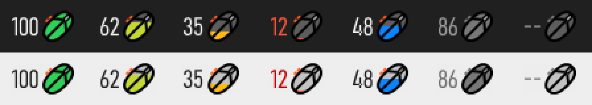

**English** | [简体中文](README.zh-CN.md)

# HypaceTray — Lofree Hypace battery level in the Windows taskbar

Shows the battery level of a Lofree Hypace mouse right in the Windows taskbar: the percentage, next to a small mouse that fills up with the charge. No need to open the web driver; hover for details.


The screenshots show the **Drawn** mouse style; by default the mouse is a photo of the Hypace in Ghost (see **Mouse style** under Features). All states (top row: dark taskbar, bottom row: light taskbar): full, 62%, 35%, 12% (number turns red), charging (blue), asleep (grey, showing the last level read), no reading yet (`--`).



> Unofficial tool, not affiliated with Lofree. It only reads the battery level and never changes any mouse settings.

## Requirements

- Windows 11 (uses the .NET Framework 4.x that comes with Windows; nothing to install). Windows 10 should work too but is untested.
- A Lofree Hypace mouse with its 8K receiver (VID `0x3554`, PID `0xFB16`). Other models and receivers are untested.

## Install and run

1. Download this repository: **Code → Download ZIP** and unzip it, or `git clone` it.
2. Open PowerShell in the repository folder and run the command below. It builds `build\HypaceTray.exe` with the C# compiler that ships with Windows; no Visual Studio or .NET SDK needed:

   ```powershell
   powershell -ExecutionPolicy Bypass -File .\build.ps1
   ```

3. Double-click `build\HypaceTray.exe`. To start it with Windows, tick **Start with Windows** in its right-click menu.
4. On first run Windows usually tucks the new tray icon under `^`, so the battery first shows left of `^`. Open `^` and drag the number icon onto the taskbar (or turn HypaceTray on under Settings → Personalization → Taskbar → Other system tray icons); the battery then shows right of `^`.

The menus, hover tips and notifications come in English (the default) and Chinese; switch at any time under **Language** in the right-click menu.

## Features

- Right of the tray's `^` sits one block: the battery percentage, next to a Hypace mouse laid along the diagonal, 20% larger than a normal tray icon. The block takes a single tray slot and follows it when tray icons come and go.
- The charge rises from the bottom of the mouse. At 20% and below the number itself turns orange or red; a notification pops up once at 20% and once at 10%.
- While charging, the number climbs and the mouse fills up as the level rises, and a small bolt sits at the mouse's bottom right, like the bolt on Windows' own battery icon (white on a dark taskbar, black on a light one). The bolt is on by default; untick **Mouse style → Show charging bolt** to hide it.
- A grey number and a colourless mouse mean the mouse is asleep and the last level read is shown; `--` with an empty mouse means no level has been read yet or the receiver was not found (hover to see the last level).
- **Mouse style** in the right-click menu picks the mouse:
  - **Realistic** (the default): the Hypace's product photo in one of its three colourways: **Crayon Grey**, **Jet Black** or **Ghost** (the default). The same submenu picks how the photo shows the level:
    - **Drained part turns grey-white**: the charged part keeps the mouse's own colour, the part above it turns a pale grey-white.
    - **Drained part turns see-through** (the default): the charged part keeps the mouse's own colour, the part above it turns faint, so the taskbar shows through it.
    - **Charged part in level colours**: the charged part takes the drawn style's level colours (below) with the photo's light and shade, the orange side buttons keep their colour, and the part above turns grey-white.
  - **Drawn**: a line drawing seen from above (wheel, Λ-shaped button seams, centre line, orange side buttons on the left), as in the screenshots. The charge's colour follows the level: 100% green → 70% yellow-green → 45% yellow → 25% orange → 10% and below red, blending smoothly in between, and turns blue while charging. The drained part is a translucent shell, so the whole mouse is always visible. The outline, centre line, seams and wheel well are 2 px black lines (black lines on colour look thinner than white lines, so they are a little wider than the taskbar's 1.5 px white strokes to look equally heavy).
  - The realistic style needs one product photo per colourway. It is downloaded from lofree.co the first time that colourway is shown (for the default Ghost, at the first start) and kept on this computer (in `%APPDATA%\HypaceTray\photos`), so it is not downloaded again. Until the photo is there the drawn mouse is shown; the menu shows "(downloading…)" next to the colourway, or "(download failed, will retry)" if it could not be fetched, and it tries again a minute later. The photos are © Lofree and are not part of this repository. Pick **Drawn** if the program should never go online.
- Follows the taskbar's dark or light theme.
- Left click: refresh now. Right-click menu: **Refresh now** / **Start with Windows** / **Open the official web driver** / **Mouse style** / **Language** (English or 中文) / **Exit**.
- Reads the battery every 60 seconds while the mouse is online, and checks every 20 seconds whether it has come online.

### How it is displayed

- A transparent tray icon holds a slot in the tray, and the battery block is a small window attached to the taskbar on top of it (the same technique TrafficMonitor uses on Windows 11). Because it is covered, that slot cannot be dragged to reorder it.
- If the transparent icon gets tucked under `^`, the block moves to the left of `^`; drag the number icon from `^` onto the taskbar and the block returns to the right of `^`.
- If the block cannot attach to the taskbar (a taskbar on the side of the screen, or a future Windows change), the program falls back to two tray icons (number + mouse); new tray icons may land under `^`, just drag them out.
- Low-battery notifications need a tray icon, so the mouse icon appears in the tray for about ten seconds during a notification, then hides again.

## Development

- `build.ps1` builds three programs: `HypaceTray.exe` (the tray program), `icontests.exe` (tests for the icon drawing and the menu texts; it should print `PASS`) and `probe.exe [seconds]` (a command-line debugging tool that prints the receiver's raw replies and the battery level).

## How it works

The official web driver at https://www.lofree.tech/ talks to the receiver over WebHID; this program speaks the same HID protocol locally:

- Device: VID `0x3554`, PID `0xFB16` (8K receiver, product name `Hypace@Lofree`), vendor-defined collection on usage page `0xFF02`, input and output report ID `0x08`, 16 bytes long.
- Packet format: `[cmd, 0, 0, 0, len, data…, checksum]`, with `checksum = (0x55 - sum(byte0..14) - 0x08) & 0xFF`.
- Commands used: `0x01` handshake, `0x03` is the mouse online (reply byte5 = 1 means online), `0x04` battery (reply byte5 = level %, byte6 = charging, byte7..8 = voltage in mV).
- As in the official driver, the percentage comes from a voltage table (3050–4110 mV, in 5% steps).
- The receiver reports `0x0A` by itself when the mouse's state changes, and the program refreshes at once.

## License

[MIT](LICENSE): free to use, modify and distribute, as long as the copyright notice is kept.
