<div align="center">

**English** | [简体中文](README.zh-CN.md)

# HypaceTray

Battery level of the Lofree Hypace mouse, right in the Windows taskbar.

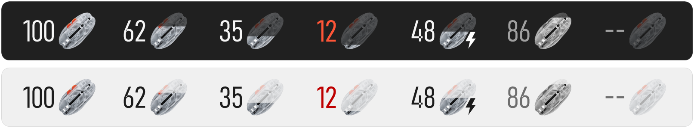

<sub>On a dark and a light taskbar: 100%, 62%, 35%, 12%, charging, asleep (last level read), no reading yet</sub>

</div>

HypaceTray puts the Hypace's battery level right of the taskbar's `^`: the percentage, next to a picture of the mouse that fills up with the charge. It talks to the mouse's 8K receiver directly, so there is no web driver to open; hover for details, left-click to refresh.

Two more colourways, three ways of showing the level and a drawn style are in the right-click menu: see the **[Gallery](#gallery)**.

> [!NOTE]
> Unofficial tool, not affiliated with Lofree. It only reads the battery level and never changes any mouse settings.

## Requirements

- Windows 11, using the .NET Framework 4.x that comes with it; nothing to install. Windows 10 should work too but is untested.
- A Lofree Hypace mouse with its 8K receiver (VID `0x3554`, PID `0xFB16`). Other models and receivers are untested.

## Install and run

1. Download `HypaceTray.exe` from the [latest release](https://github.com/GentleJinqi/Lofree-Hypace-tray-Battery-Icon/releases/latest) and put it in a folder of its own. **Start with Windows** remembers where the program is, so choose the folder first.
2. Double-click it. The program is not signed, so Windows may say "Windows protected your PC": click **More info**, then **Run anyway**.
3. To start it with Windows, tick **Start with Windows** in its right-click menu.
4. On first run Windows usually tucks the new tray icon under `^`, so the battery first shows left of `^`. Open `^` and drag the number icon onto the taskbar (or turn HypaceTray on under Settings → Personalization → Taskbar → Other system tray icons); the battery then shows right of `^`.

Each release is built by GitHub Actions from that version's source code; the release page gives the exe's SHA-256.

### Build it yourself

To change the code, or to run a program you built yourself:

1. Download this repository: **Code → Download ZIP** and unzip it, or `git clone` it.
2. Open PowerShell in the repository folder and build `build\HypaceTray.exe` with the C# compiler that ships with Windows (no Visual Studio or .NET SDK needed):

   ```powershell
   powershell -ExecutionPolicy Bypass -File .\build.ps1
   ```

3. Run `build\HypaceTray.exe` as above.

## Features

- **One block in the tray.** The percentage and the mouse sit right of `^` in a single tray slot, the mouse 20% larger than a normal tray icon, and follow the tray as icons come and go.
- **Level at a glance.** The charge rises from the bottom of the mouse. At 20% and below the number turns orange, then red, and a notification pops up at 20% and again at 10%.
- **Charging.** The number climbs, the mouse fills up, and a small bolt sits at its bottom right, like the one on Windows' own battery icon.
- **Asleep or not found.** A grey number and a colourless mouse mean the mouse is asleep and the last level read is shown; `--` with an empty mouse means no level yet or no receiver (hover for the last level).
- **Number optional.** Untick **Show battery percentage** to show the mouse alone.
- **Dark or light taskbar**, followed automatically.
- **English or Chinese**, English by default.
- Reads the battery every 60 seconds while the mouse is online, and checks every 20 seconds whether it has come online.

### Right-click menu

| Item | What it does |
| --- | --- |
| **Refresh now** | Reads the battery at once (a left-click does the same). |
| **Start with Windows** | Starts HypaceTray when you sign in. |
| **Open the official web driver** | Opens https://www.lofree.tech/ in the browser. |
| **Show battery percentage** | The number next to the mouse, on by default; untick it for the mouse alone. |
| **Mouse style** | The mouse picture and the charging bolt, see below. |
| **Language** | English or 中文. |
| **Exit** | Closes HypaceTray. |

### Mouse style

- **Realistic** (default): a photo of the Hypace in **Crayon Grey**, **Jet Black** or **Ghost** (default), showing the level in one of three ways:
  - **Drained part turns grey-white**: above the charge, the mouse turns a pale grey-white.
  - **Drained part turns see-through** (default): above the charge, the mouse turns faint and the taskbar shows through.
  - **Charged part in level colours**: the charge takes the drawn style's colours, keeping the photo's light and shade; above it, grey-white.
- **Drawn**: a line drawing of the Hypace seen from above. The charge is green at 100% and turns yellow-green, yellow, orange and red as it falls (70%, 45%, 25%, 10%), blue while charging; the drained part is a translucent shell.
- **Show charging bolt**: on by default.

The realistic style uses Lofree's product photo of each colourway. The photos are in [`photos/`](photos/) and built into `HypaceTray.exe`, so nothing is downloaded and the program never goes online.

## Gallery

Drawn by the program itself, larger than on the taskbar. Mouse photos © Lofree.

<details>
<summary><b>Every colourway in every state</b></summary>
<br>

Dark taskbar above, light below: 100%, 62%, 35%, 12%, charging, asleep, no reading yet. Drained part see-through (the default).

**Crayon Grey**

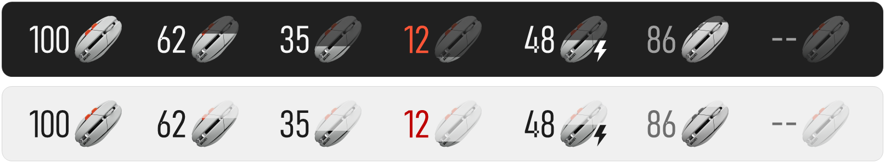

**Jet Black**

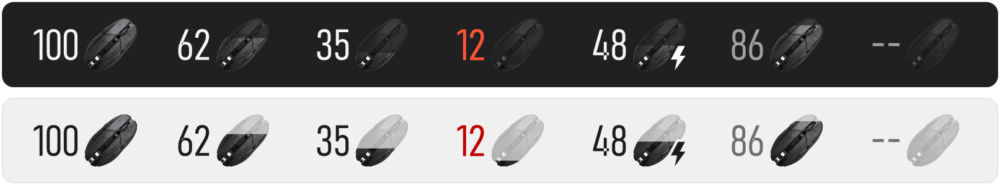

**Ghost** (default)


</details>

<details>
<summary><b>The three level displays</b></summary>
<br>

Each picture: 62% and charging.

| | Crayon Grey | Jet Black | Ghost |
| --- | :---: | :---: | :---: |
| **Drained part turns grey-white** | 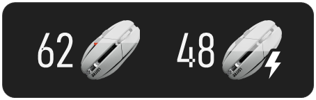 | 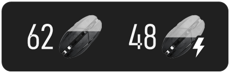 | 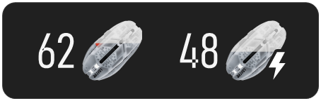 |
| **Drained part turns see-through** (default) | 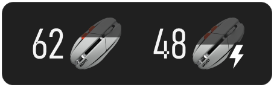 | 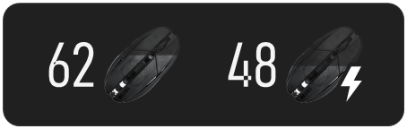 | 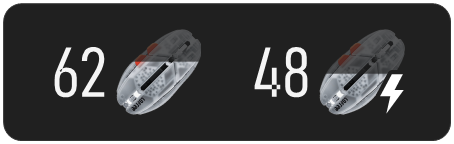 |
| **Charged part in level colours** | 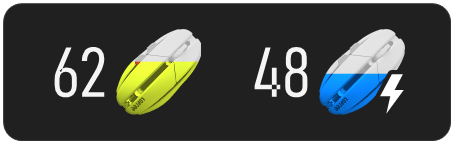 | 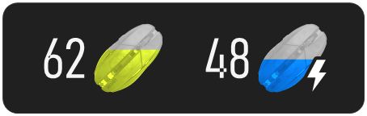 | 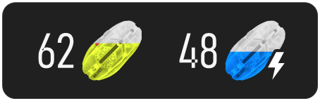 |

</details>

<details>
<summary><b>Without the percentage</b></summary>
<br>

**Show battery percentage** unticked: dark taskbar above, light below, in the same states.

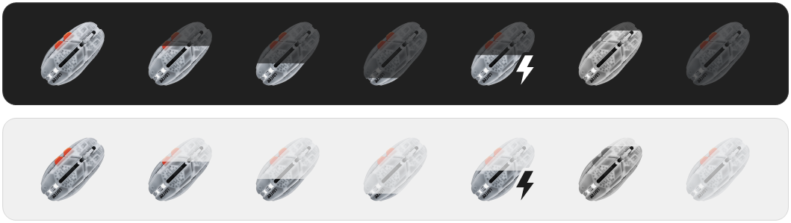

</details>

<details>
<summary><b>Drawn style</b></summary>
<br>

Dark taskbar above, light below, in the same states.

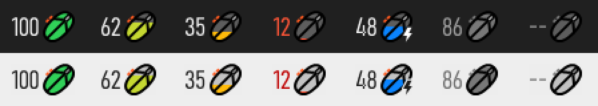

</details>

## How it sits in the taskbar

- A transparent tray icon holds a slot in the tray, and the battery block is a small window attached to the taskbar on top of it (the same technique TrafficMonitor uses on Windows 11). Because it is covered, that slot cannot be dragged to reorder it.
- If the transparent icon gets tucked under `^`, the block moves to the left of `^`; drag the number icon from `^` onto the taskbar and the block returns to the right of `^`.
- If the block cannot attach to the taskbar (a taskbar on the side of the screen, or a future Windows change), the program falls back to two tray icons (number + mouse); new tray icons may land under `^`, just drag them out.
- Low-battery notifications need a tray icon, so the mouse icon appears in the tray for about ten seconds during a notification, then hides again.

## Development

`build.ps1` builds three programs: `HypaceTray.exe` (the tray program), `icontests.exe` (tests for the icon drawing and the menu texts; it should print `PASS`) and `probe.exe [seconds]` (a command-line debugging tool that prints the receiver's raw replies and the battery level).

GitHub Actions builds and tests every push to `main`. Pushing a version tag such as `v1.0.1` (the same version as in `src/AssemblyInfo.cs`) also publishes a release with the `HypaceTray.exe` it built.

## How it works

The official web driver at https://www.lofree.tech/ talks to the receiver over WebHID; this program speaks the same HID protocol locally:

- Device: VID `0x3554`, PID `0xFB16` (8K receiver, product name `Hypace@Lofree`), vendor-defined collection on usage page `0xFF02`, input and output report ID `0x08`, 16 bytes long.
- Packet format: `[cmd, 0, 0, 0, len, data…, checksum]`, with `checksum = (0x55 - sum(byte0..14) - 0x08) & 0xFF`.
- Commands used: `0x01` handshake, `0x03` is the mouse online (reply byte5 = 1 means online), `0x04` battery (reply byte5 = level %, byte6 = charging, byte7..8 = voltage in mV).
- As in the official driver, the percentage comes from a voltage table (3050–4110 mV, in 5% steps).
- The receiver reports `0x0A` by itself when the mouse's state changes, and the program refreshes at once.

## License

[MIT](LICENSE): free to use, modify and distribute, as long as the copyright notice is kept.

The MIT license covers the code only. The product photos in [`photos/`](photos/), and the pictures of the realistic mouse made from them (in `docs/images/`), are © Lofree and are not covered by it; see [photos/README.md](photos/README.md).
