<div align="center">

[English](README.md) | **简体中文**

# HypaceTray

在 Windows 任务栏里直接显示洛斐 Hypace 鼠标的电量。

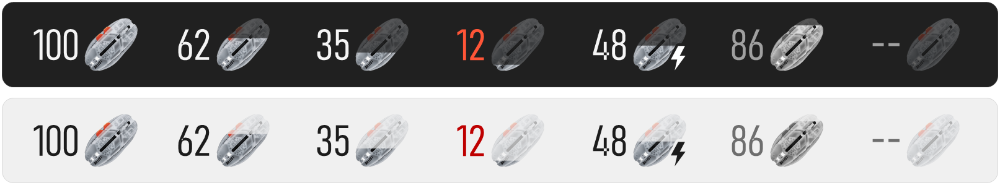

<sub>深色和浅色任务栏：100%、62%、35%、12%、充电中、休眠（显示上次读到的电量）、还没读到电量</sub>

</div>

HypaceTray 把洛斐（Lofree）Hypace 鼠标的电量显示在任务栏 `^` 的右边：电量百分比，加一只随电量填满的小鼠标。程序直接和鼠标的 8K 接收器通信，不用打开网页驱动；悬停看详细信息，左键单击立即刷新。

右键菜单里还有另外两种配色、三种电量显示方式和线条样式，见 **[效果图](#效果图)**。

> [!NOTE]
> 非官方工具，和洛斐（Lofree）没有关系。程序只查询电量，不会写入任何鼠标设置。

## 需要

- Windows 11，用系统自带的 .NET Framework 4.x，不用另外安装。Windows 10 应该也能运行，但没有测试过。
- 洛斐 Hypace 鼠标和它的 8K 接收器（VID `0x3554`，PID `0xFB16`）。其他型号或接收器没有测试过。

## 安装和运行

1. 下载本仓库：点 **Code → Download ZIP** 后解压，或者 `git clone`。
2. 在仓库目录里打开 PowerShell，运行下面的命令，用 Windows 自带的 C# 编译器生成 `build\HypaceTray.exe`（不需要 Visual Studio 或 .NET SDK）：

   ```powershell
   powershell -ExecutionPolicy Bypass -File .\build.ps1
   ```

3. 双击 `build\HypaceTray.exe`。想开机自动运行，在右键菜单里勾选 Start with Windows（中文界面下是"开机自启动"）。
4. 第一次运行时，Windows 通常会把新的托盘图标收进 `^` 里，这时电量会先显示在 `^` 的左边。点开 `^`，把里面的数字图标拖到任务栏上（或者在 设置 → 个性化 → 任务栏 → 其他系统托盘图标 里打开 HypaceTray），电量就会显示在 `^` 的右边。

## 功能

- **托盘里的一整块。** 电量数字和鼠标显示在 `^` 右边，只占一个托盘格位，鼠标比普通托盘图标大 20%；托盘图标增减时会自动跟着挪位置。
- **电量一眼可见。** 鼠标里的电量从下往上涨。电量 ≤20% 时数字变成橙色、再到红色，电量降到 20% 和 10% 时各弹一次提醒。
- **充电。** 数字往上涨，鼠标跟着填满，右下角还有一个小闪电，和 Windows 自己电池图标里的闪电一样。
- **休眠或没找到接收器。** 数字变灰、鼠标没有颜色，表示鼠标在休眠，显示的是上次读到的电量；数字显示 `--`、鼠标是空的，表示还没读到电量或者没找到接收器（悬停可以看到上次的电量）。
- **深色/浅色任务栏**，自动跟随。
- **英文或中文**，默认英文。
- 鼠标在线时每 60 秒读一次电量，离线时每 20 秒检查一次是否上线。

### 右键菜单

菜单默认是英文；在 Language 里选"中文"后，就是下面这些名字。

| 菜单项 | 作用 |
| --- | --- |
| **立即刷新** | 马上读一次电量（左键单击也一样）。 |
| **开机自启动** | 登录 Windows 时自动启动 HypaceTray。 |
| **打开官方网页驱动** | 在浏览器里打开 https://www.lofree.tech/。 |
| **鼠标样式** | 鼠标的样子和充电闪电，见下。 |
| **语言** | English 或中文。 |
| **退出** | 关闭 HypaceTray。 |

### 鼠标样式

- **仿真**（默认）：Hypace 的产品照片，配色可选 **Crayon Grey**、**Jet Black**、**Ghost**（默认），电量有三种显示方式：
  - **没电部分变灰白**：电量以上的部分变成浅灰白。
  - **没电部分变透明**（默认）：电量以上的部分变淡，透出任务栏。
  - **电量部分用电量颜色**：有电的部分换成线条样式的电量颜色，保留照片的明暗；以上的部分变成灰白。
- **线条**：从上方看的 Hypace 线条画。电量 100% 时是绿色，随着电量下降依次变成黄绿、黄、橙、红（70%、45%、25%、10%），充电时变蓝；没电的部分是半透明的底壳。
- **充电时显示闪电**：默认打开。

仿真样式每种配色需要一张产品照片：第一次显示这种配色时（默认的 Ghost 就是第一次启动时）从 lofree.co 下载，保存在 `%APPDATA%\HypaceTray\photos`。下载好之前先显示线条鼠标，菜单里这个配色后面会显示"（下载中…）"，下载不了时显示"（下载失败，稍后重试）"，一分钟后再试。如果不希望程序联网，选 **线条** 即可。

## 效果图

图都是程序自己画的，比任务栏上的大。鼠标照片版权归洛斐（Lofree）所有，照片本身不包含在本仓库里。

<details>
<summary><b>三种配色的各种状态</b></summary>
<br>

上面是深色任务栏，下面是浅色任务栏：100%、62%、35%、12%、充电中、休眠、还没读到电量。没电部分变透明（默认）。

**Crayon Grey**

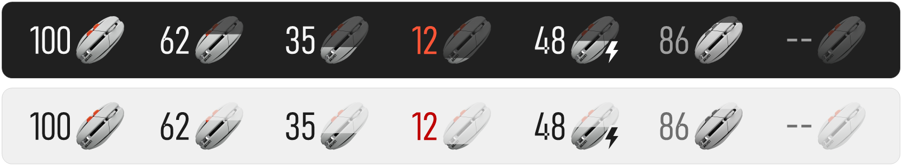

**Jet Black**

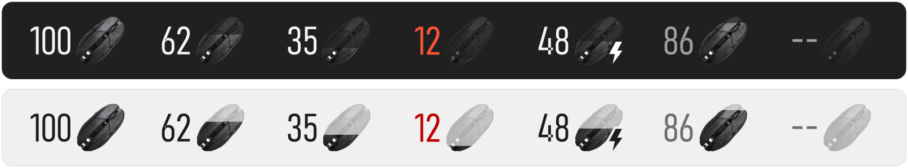

**Ghost**（默认）


</details>

<details>
<summary><b>三种电量显示方式</b></summary>
<br>

每张图：62% 和充电中。

| | Crayon Grey | Jet Black | Ghost |
| --- | :---: | :---: | :---: |
| **没电部分变灰白** | 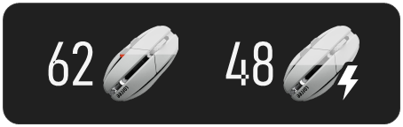 | 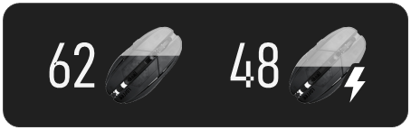 | 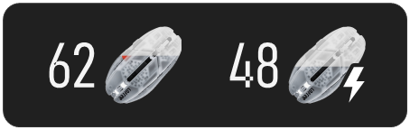 |
| **没电部分变透明**（默认） | 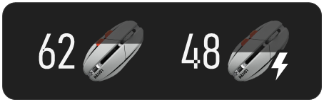 | 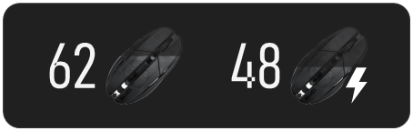 | 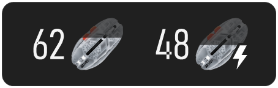 |
| **电量部分用电量颜色** | 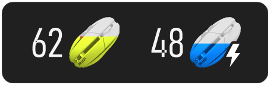 | 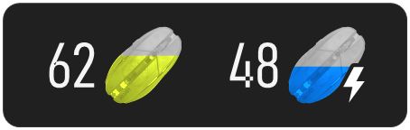 | 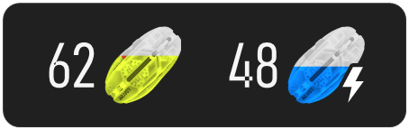 |

</details>

<details>
<summary><b>线条样式</b></summary>
<br>

上面是深色任务栏，下面是浅色任务栏，状态同上。


</details>

## 在任务栏里的显示方式

- 托盘里有一个透明的托盘图标占住格位，电量这一块是盖在它上面、贴在任务栏上的小窗口（和 TrafficMonitor 在 Windows 11 上的做法一样）。因为被盖住了，这个格位没法拖动排序。
- 如果那个透明图标被收进了 `^`，这一块会改到 `^` 的左边显示；把 `^` 里的数字图标拖到任务栏上，这一块就会回到 `^` 右边。
- 万一贴不上任务栏（比如任务栏放在侧边，或者以后 Windows 改了任务栏），会自动改用两个托盘图标（数字 + 鼠标）显示；新的托盘图标可能被收进 `^`，拖出来即可。
- 低电量提醒需要托盘图标才能弹出，所以提醒时鼠标图标会在托盘里出现十秒左右，然后自动隐藏。

## 开发

`build.ps1` 同时生成三个程序：`HypaceTray.exe`（托盘程序）、`icontests.exe`（图标绘制和菜单文字的测试，运行后应显示 `PASS`）、`probe.exe [秒数]`（命令行调试工具，打印接收器返回的原始数据和电量）。

## 原理

官方网页驱动 https://www.lofree.tech/ 通过 WebHID 和接收器通信，本程序在本机用同样的 HID 协议通信：

- 设备：VID `0x3554`，PID `0xFB16`（8K 接收器，产品名 `Hypace@Lofree`），厂商自定义集合 Usage Page `0xFF02`，输入/输出报告 ID 均为 `0x08`，长度 16 字节。
- 报文格式：`[cmd, 0, 0, 0, len, data…, checksum]`，`checksum = (0x55 - sum(byte0..14) - 0x08) & 0xFF`。
- 用到的命令：`0x01` 握手，`0x03` 查询鼠标是否在线（回复的 byte5 为 1 表示在线），`0x04` 查询电量（回复 byte5 = 电量%，byte6 = 是否充电，byte7..8 = 电压 mV）。
- 电量百分比和官方驱动一样，由电压查表换算（3050–4110 mV，每档 5%）。
- 接收器在鼠标状态变化时会主动上报 `0x0A`，程序收到后会立即刷新。

## 许可

[MIT](LICENSE)：可以自由使用、修改和分发，保留版权声明即可。
