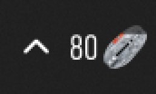
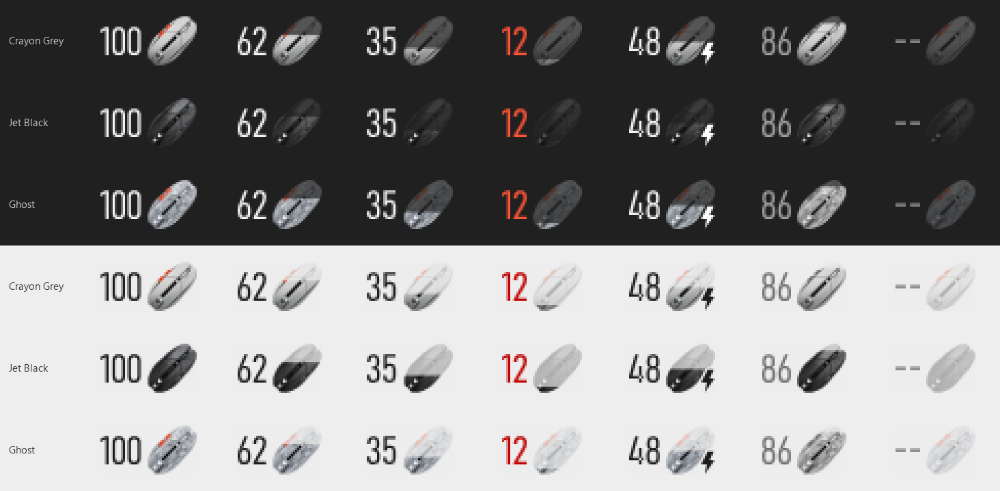
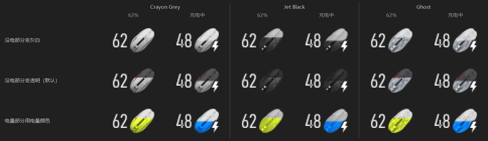
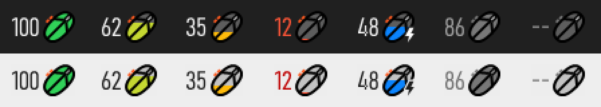

[English](README.md) | **简体中文**

# HypaceTray — 在任务栏托盘显示洛斐 Hypace 鼠标电量

在 Windows 任务栏托盘里直接显示洛斐（Lofree）Hypace 鼠标的电量：百分比数字，加一只随电量填满的小鼠标。不用打开网页驱动，悬停可以看到详细信息。



默认的鼠标是 Hypace Ghost 配色的产品照片，没电部分变透明。三种配色的各种状态（上面三排深色任务栏，下面三排浅色任务栏）：满电、62%、35%、12%（数字变红）、充电中（带闪电）、休眠（没有颜色，显示上次读到的电量）、还没读到电量（`--`）。



仿真鼠标显示电量的三种方式（在"鼠标样式 → 仿真"里选），62% 和充电中：



"线条"样式的同样这些状态（上排深色任务栏，下排浅色任务栏），充电时变蓝：



鼠标照片版权归洛斐（Lofree）所有；上面这些图是程序自己画出的 20 像素图标，放大了 3 倍。

> 非官方工具，和洛斐（Lofree）没有关系。程序只查询电量，不会写入任何鼠标设置。

## 需要

- Windows 11（用到系统自带的 .NET Framework 4.x，不用另外安装）。Windows 10 应该也能运行，但没有测试过。
- 洛斐 Hypace 鼠标和它的 8K 接收器（VID `0x3554`，PID `0xFB16`）。其他型号或接收器没有测试过。

## 安装和运行

1. 下载本仓库：点 **Code → Download ZIP** 后解压，或者 `git clone`。
2. 在仓库目录里打开 PowerShell，运行下面的命令。它用 Windows 自带的 C# 编译器生成 `build\HypaceTray.exe`，不需要安装 Visual Studio 或 .NET SDK：

   ```powershell
   powershell -ExecutionPolicy Bypass -File .\build.ps1
   ```

3. 双击 `build\HypaceTray.exe`。想开机自动运行，在右键菜单里勾选 Start with Windows（中文界面下是"开机自启动"）。
4. 第一次运行时，Windows 通常会把新的托盘图标收进 `^` 里，这时电量会先显示在 `^` 的左边。点开 `^`，把里面的数字图标拖到任务栏上（或者在 设置 → 个性化 → 任务栏 → 其他系统托盘图标 里打开 HypaceTray），电量就会显示在 `^` 的右边。

菜单、悬停提示和通知有英文（默认）和中文两种，随时可以在右键菜单的 Language（中文界面下叫"语言"）里切换。

## 功能

- 托盘里 `^` 的右边显示一整块：电量百分比的数字，紧挨着一只沿对角线斜放的 Hypace 鼠标，比普通托盘图标大 20%。它只占一个托盘格位，托盘图标增减时会自动跟着挪位置。
- 鼠标里的电量从下往上涨。电量 ≤20% 时，数字本身也会变成橙色或红色；电量降到 20% 和 10% 时各弹一次提醒。
- 充电时，数字随电量往上涨，鼠标里的电量也跟着往上填；鼠标右下角还有一个小闪电，和 Windows 自己电池图标里的闪电一样（深色任务栏上是白色，浅色任务栏上是黑色）。闪电默认打开，不想要的话，在右键菜单的"鼠标样式 → 充电时显示闪电"里取消勾选。
- 数字变灰、鼠标没有颜色，表示鼠标在休眠，显示的是上次读到的电量；数字显示 `--`、鼠标是空的，表示还没读到过电量，或者没找到接收器（悬停可以看到上次的电量）。
- 右键菜单的"鼠标样式"可以选鼠标的样子：
  - "仿真"（默认）：用 Hypace 的产品照片，三种配色任选：Crayon Grey、Jet Black、Ghost（默认）。同一个子菜单里还能选照片怎么显示电量：
    - "没电部分变灰白"：有电的部分保持鼠标本来的颜色，上面没电的部分变成浅灰白。
    - "没电部分变透明"（默认）：有电的部分保持鼠标本来的颜色，上面没电的部分变淡，能透出任务栏。
    - "电量部分用电量颜色"：有电的部分换成线条样式的电量颜色（见下），保留照片的明暗，橙色侧键保持原色；上面没电的部分变成灰白。
  - "线条"：从上方看的线条鼠标（滚轮、倒 V 按键分缝、中缝、左侧橙色侧键），就是上面最后一张图里的样子。电量的颜色随电量变化：100% 绿 → 70% 黄绿 → 45% 黄 → 25% 橙 → 10% 以下红，中间平滑过渡，充电时变蓝。没电的部分是半透明的底壳，整只鼠标始终看得见；鼠标的外圈、中缝、分缝和滚轮槽用 2 像素黑线画（黑线在彩色上看起来比白线细，所以比任务栏 1.5 像素的白线宽一点，视觉上一样粗）。
  - 仿真样式每种配色需要一张产品照片：第一次显示这种配色时（默认的 Ghost 就是第一次启动时）从 lofree.co 下载，保存在本机（`%APPDATA%\HypaceTray\photos`），以后不再下载。照片下载好之前先显示线条鼠标；菜单里这个配色后面会显示"（下载中…）"，下载不了时显示"（下载失败，稍后重试）"，一分钟后再试。照片版权归洛斐（Lofree）所有，不包含在本仓库里，仓库里只有上面那些小图标渲染图。如果不希望程序联网，选"线条"即可。
- 跟随任务栏的深色/浅色主题。
- 左键单击：立即刷新。右键菜单：立即刷新 / 开机自启动 / 打开官方网页驱动 / 鼠标样式 / 语言（English 或 中文）/ 退出。
- 鼠标在线时每 60 秒读一次电量，离线时每 20 秒检查一次是否上线。

### 显示方式说明

- 托盘里有一个透明的托盘图标占住格位，电量这一块是盖在它上面、贴在任务栏上的小窗口（和 TrafficMonitor 在 Windows 11 上的做法一样）。因为被盖住了，这个格位没法拖动排序。
- 如果那个透明图标被收进了 `^`，这一块会改到 `^` 的左边显示；把 `^` 里的数字图标拖到任务栏上，这一块就会回到 `^` 右边。
- 万一贴不上任务栏（比如任务栏放在侧边，或者以后 Windows 改了任务栏），会自动改用两个托盘图标（数字 + 鼠标）显示；新的托盘图标可能被收进 `^`，拖出来即可。
- 低电量提醒需要托盘图标才能弹出，所以提醒时鼠标图标会在托盘里出现十秒左右，然后自动隐藏。

## 开发

- `build.ps1` 同时生成三个程序：`HypaceTray.exe`（托盘程序）、`icontests.exe`（图标绘制和菜单文字的测试，运行后应显示 `PASS`）、`probe.exe [秒数]`（命令行调试工具，打印接收器返回的原始数据和电量）。

## 原理

官方网页驱动 https://www.lofree.tech/ 通过 WebHID 和接收器通信，本程序在本机用同样的 HID 协议通信：

- 设备：VID `0x3554`，PID `0xFB16`（8K 接收器，产品名 `Hypace@Lofree`），厂商自定义集合 Usage Page `0xFF02`，输入/输出报告 ID 均为 `0x08`，长度 16 字节。
- 报文格式：`[cmd, 0, 0, 0, len, data…, checksum]`，`checksum = (0x55 - sum(byte0..14) - 0x08) & 0xFF`。
- 用到的命令：`0x01` 握手，`0x03` 查询鼠标是否在线（回复的 byte5 为 1 表示在线），`0x04` 查询电量（回复 byte5 = 电量%，byte6 = 是否充电，byte7..8 = 电压 mV）。
- 电量百分比和官方驱动一样，由电压查表换算（3050–4110 mV，每档 5%）。
- 接收器在鼠标状态变化时会主动上报 `0x0A`，程序收到后会立即刷新。

## 许可

[MIT](LICENSE)：可以自由使用、修改和分发，保留版权声明即可。
